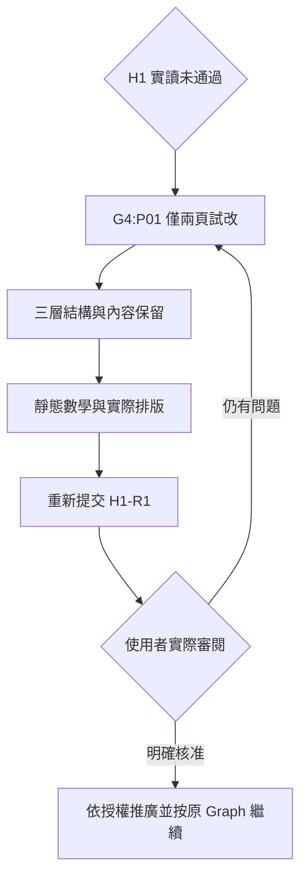

# H1-R1：由實際驗收失敗新增的 G4 檢查

2026-11-18 使用者實讀後否決 H1：難度超過先備，公式未在其閱讀介面正常顯示。先前 G4 結構通過不構成教學適合或閱讀環境支援數學的證明。

只試改 P01 主筆記及片電阻推導。其餘四篇、共享概念頁及其他推導保持原樣，須使用者明確核准才能推廣。G5 及 H2 仍受 H1 依賴約束。

Graph 1.1 的既有 run 與 graph-snapshot 不覆寫；本文件是該 run 的修訂驗收契約，由 G4:P01 第 2 次結果引用。新增的 submit 命令只重新提交人工審閱包，不核准 H1。

| 提前至 G4 的檢查 | 產物／完成標準 | 失敗路徑 |
|---|---|---|
| 三層教學 | Level 1 解釋名詞、動機、直覺、比喻限制；Level 2 從已學課程銜接；Level 3 保留研究深度與疑點 | 回 G4:P01；理解程度交 H1 使用者判斷 |
| 內容保留 | 前版備份與差異；保留重要結果、來源、原式、單位、符號、假設及研究用途 | 遺漏回 G4；來源疑問回 G2/G3，不補猜 |
| 靜態數學 | 定界符、大括號、重複跳脫、表格及連結碰撞逐項記錄 | 修正對應公式再查 |
| 實際排版 | 引擎與版本、輸入雜湊、預期及實際數量、獨立模式、錯誤節點、截圖 | 少式、錯誤或模式不符，修正 Markdown／預覽後重測 |
| 環境區分 | 使用者故障介面、已測與未測環境分列 | 不把 MathJax 通過冒充 Obsidian／Codex 通過 |
| 修訂範圍 | 其餘既有筆記逐檔雜湊不變 | 非授權變更先停止並核查 |

靜態工具不是完整 TeX 解析器，排版數量不是學術審查，也不能為通過而變更預期數量。



沿用每實例最多 3 次、每輪最多 6 次修正退回；G4:P01 本次第 2 次。資料不足、重大矛盾或達上限時停止。預覽工具開發調整與正式節點嘗試分開記錄，不虛增論文錯誤次數。

```sh
python -B tools/math_check.py PRIVATE_P01 PRIVATE_DERIVATION --output PRIVATE_REPORT
python -B tools/wiki.py status
python -B tools/wiki.py begin G4:P01
python -B tools/wiki.py record G4:P01 --result PRIVATE_G4_REVISION_RESULT
python -B tools/wiki.py submit H1 --result PRIVATE_H1_REVISION_PACKAGE
python -B tools/wiki.py export
```

PRIVATE 引數須換為環境內實際私人路徑。submit 保留既有否決、修訂包與依賴雜湊，停在 awaiting_review。只有實際使用者回覆後才可 review approve。
