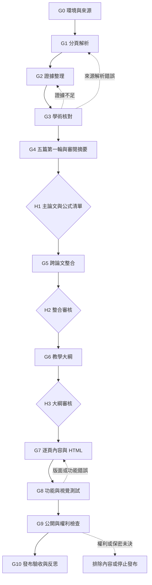

# Graph 操作

本工具保存可重複執行的步驟與真實結果；AI 整理由 Codex 執行，不另呼叫付費模型 API。學術判讀不是 Python 自動保證的事項。

## 私人輸入

私人區預設為 Repo 同層 `gan-hemt-private`，或由環境變數 `GAN_WIKI_PRIVATE_ROOT` 指定。必須位於公開 Repo 外。私人區的 `inputs.json` 形狀如下（把值替換為該環境實際可讀的檔案路徑；不要提交此檔）：

```json
{"sources":{"P01":"私人來源的 P01.pdf 路徑","P02":"私人來源的 P02.pdf 路徑","P03":"私人來源的 P03.pdf 路徑","P04":"私人來源的 P04.pdf 路徑","P05":"私人來源的 P05.pdf 路徑"}}
```

雲端執行時必須重新提供該環境可讀的私人來源並實際驗證。不把本機成功等同雲端成功；缺檔時停止，不把來源塞進公開 Repo。

## 固定操作

```sh
python tools/wiki.py start
python tools/wiki.py ingest
python tools/wiki.py status
python tools/wiki.py begin G2:P01
python tools/wiki.py record G2:P01 --result ../gan-hemt-private/results/G2-P01.json
python tools/wiki.py fail G2:P01 --code unsupported_claim
python tools/wiki.py check
python tools/wiki.py export
```

`start` 產生私人 run ID 與狀態；`ingest` 真正完成 G0 與各來源 G1。再次執行時，已通過且輸入未變的節點會跳過。來源變更需新 run 或明確失效重跑；原始副本不同時拒絕覆蓋。

`begin` 檢查依賴與重試上限；`record` 只接受 running 節點與符合節點規格的結果檔。`fail` 保存失敗、將來源 ID 代入路由，並使指定上游及相關下游失效；修正後執行該節點，缺少路由則停止檢查。`status` 與 `record` 會檢查已記錄輸出是否變更並失效下游。

結果 JSON 至少含 `checks`（物件，各項檢查 ID 對應 passed）、`outputs`（實際成果檔案路徑）、`scope`（本次實際核對範圍）與 `open_items`。G2 額外含 `evidence`，每筆學術主張必須有 `source_id`、`pdf_page`、`claim`、`basis`（paper/external/ai/pending）及 `status`；外部來源另外帶可核對書目。G3 記錄核對依據與未完成公式；G4 附實際筆記及逐篇審閱摘要。工具驗證的是結構與位置，不自行確認敘述受原文支持。

人工關卡採：

```sh
python tools/wiki.py review H1 --decision approve --statement "使用者實際核准回覆" --reference "核准回覆所在對話及時間"
```

只有使用者真的核准後，才由 Codex 登錄；此命令不會也不能驗證使用者身分，不得用虛構 statement 解除關卡。紀錄綁定被審閱輸入的雜湊，改稿後核准即失效。reject 會保存意見並停在等待審核。

`invalidate NODE --reason 說明` 把指定節點及受影響下游標記 stale，保留舊嘗試。重試上限不因 invalidate 重置。每個實例總計最多 3 次 begin，整輪最多 6 次修正重跑；到上限停止。

`export` 只輸出列舉欄位的公開摘要，不複製私人原始 log、來源片段、抽取文字或絕對路徑。輸出後仍須公開檢查。`manifest` 只登錄專案自寫檔案；含論文研究內容的頁面須另確認公開狀態，不得自動列入。

## 流程

H1 實讀失敗後的本次試改依 [H1-R1 修訂契約](H1-R1.md)。`python tools/wiki.py submit H1 --result PRIVATE_PACKAGE` 可保留原否決並重新提交修訂包，停在 awaiting_review；不解除 G5 或 H2。



G1–G4 以論文為處理對象。五篇第一輪均完成後集中 H1；G5、G6 及後續各自遵守依賴，不會因某篇完成就強迫全流程停下。
